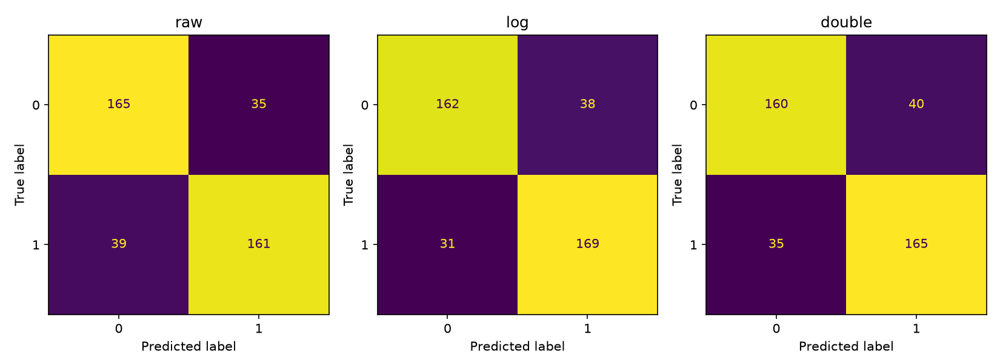

# 지능형 문서 검색

NumPy TF-IDF와 코사인 검색을 직접 구현하고 공개 영화 리뷰2,000개의 검색/분류 실험을 수행했습니다.

## 구현 요약

### 데이터와 전처리

Bo Pang/Lillian Lee의 Sentiment Polarity Dataset2.0을 NLTK의 고정 revision으로 받았습니다. [배포 메타데이터](licenses/movie_reviews.xml)는 CC BY4.0이며 출처/해시는 [자료 목록](resources/sources.json)에 있습니다. 실제 긍정/부정 리뷰 각1,000개를 사용했습니다.

검토한 일반 어휘658개만 입력 표현에 남기고 나머지 단어는 UNK로 가렸습니다. 숫자/연락처 형식은 제외하고 원문은 저장소에 포함하지 않았습니다. 실제 남은 단어 비율은57.69%입니다. UNK의 위치와 문장 경계는 유지해 규칙 분석에서 부정어 거리가 바뀌지 않게 했습니다. 이 제한으로 고유명사/전문 용어와 일부 의미도 함께 손실됩니다.

소문자화하고 단어 내부 apostrophe/hyphen을 허용합니다. 벡터화는 구두점/UNK와 관사/대명사/일반 조동사를 제외하며 not/no/never와can't같은 부정 축약형은 보존합니다. movies→movie같은 명사 복수형만 통일하고, good/excellent의 강도 차이를 보존하려고 자동 동의어 통합은 하지 않았습니다.

일반 감성 어휘는 [VADER](https://github.com/cjhutto/vaderSentiment)의 단어를 검토해 선택했고 [MIT 저작권](licenses/VADER-LICENSE.txt)을 보존했습니다. 해당 분석기는 호출하지 않습니다. 토큰화/TF-IDF/코사인은 직접 구현하고 Scikit-learn은 검산/분류에 사용합니다.

### 수식과 검색

TF는raw=count,log=1+ln(count),double=0.5+0.5*count/max_count를 비교하며 빈 단어는0입니다. 기본 IDF는ln((N+1)/(DF+1))+1이고 TF*IDF를 문서의L2길이로 나눕니다. 쿼리도 같은 IDF로 변환해 두 L2벡터의 내적을 코사인으로 계산합니다. 미지어/영벡터는0으로 처리합니다.

BM25는k1=1.5,b=0.75,양의IDF=ln(1+(N-DF+0.5)/(DF+0.5))를 사용합니다. 문서 길이와 평균 길이는 같은 정제 토큰에서 계산합니다. 역색인은단어별 비제로 문서 ID/가중치를 저장해 쿼리 단어의 목록만 누적합니다.

### 설치와 사용

Python3.12.14/NumPy2.5.4/Scikit-learn1.9.1/Matplotlib3.11.2의 전용venv에서 실행했습니다.

```bash
python3.12 -m venv .venv
source .venv/bin/activate
python -m pip install -r requirements.txt
python prepare_data.py --download
python -m unittest discover -s tests -v
python experiments.py verify
python experiments.py classification
python experiments.py search
python experiments.py benchmark
python main.py --query "good acting interesting story" --topk 5
```

main.py는점수/ID/정제 어휘 스니펫을 출력합니다. --method raw/log/double/bm25로 바꿀 수 있습니다. search(query, records, topk=5)는같은 내용의 튜플 목록을 반환합니다.

## 검증과 실험

### 수치 검증

손계산 TF/IDF/BM25,영벡터,미지어,누수/역색인과식별문자열제거의8개 검사가 통과했습니다. [검산 원본](outputs/verification.json)의 TfidfVectorizer는 같은tokenizer/vocabulary,lowercase=False/token_pattern=None을 사용했습니다.

| TF | smooth_idf | norm | 최대 절대 오차 |
|---|---|---|---:|
| raw | True | None | 0.000e+00 |
| raw | True | l2 | 4.441e-16 |
| raw | False | None | 0.000e+00 |
| raw | False | l2 | 3.331e-16 |
| log | True | None | 0.000e+00 |
| log | True | l2 | 1.665e-16 |
| log | False | None | 0.000e+00 |
| log | False | l2 | 1.665e-16 |

2,000x549 행렬의8설정 모두1e-6 이내였습니다. 이 검산에서 학습한 IDF는 분류 실험에 재사용하지 않습니다.

### 고정 분할의 분류와 TF 비교

층화8:2/random_state42의 Train1,600/Test400을 고정했습니다. TF/IDF는 각 Train에서만 fit하고 LogisticRegression C1/max_iter2000을 사용했습니다. 기본log TF는 비교 전에 정했으며 Test성능으로 선택하지 않았습니다. Train어휘는547개로 전체 검색용549개와 구분됩니다.

| TF | Accuracy | F1 |
|---|---:|---:|
| raw | 0.8150 | 0.8131 |
| log | 0.8275 | 0.8305 |
| double | 0.8125 | 0.8148 |



Log TF는반복되는 단어의 영향을 완화했고 이 분할에서 F1이 가장 높았습니다. Double TF가 항상 나은 것은 아니며0.5의기본값이 희귀 단어의 상대 가중치를 높이는 효과도 있습니다.

### 검색과 BM25

```text
0.371087	review-0604	up old much movie quite boring very story well quite acting very good character development quite interesting but story not enough into movie few things about story didn't very wel
0.338760	review-1253	good movies film good story fresh film under good script just but acting over role over like rich character good else good but man doesn't up story but whose doesn't make like
0.294648	review-1900	most not start part enough like makes time romance movie about great many even not other movie shows maybe not but still shows very story story interesting story although most prem
0.275956	review-0783	isn't much good about movie not much about acting directing make seeing movie so good out didn't about movie down end plot interesting but while ridiculous things into fascinating
0.261022	review-1931	like great musical work few movies style why good film almost too many story feels through into young feels but same time brilliance through through acting acting emotion through p
```

세 쿼리에서 top5의log TF 대비 Jaccard를 비교했습니다. 이는순위 구성의 변화이며 사람의 의미 관련성 정답을 측정한 지표가 아닙니다.

| 방법 | 쿼리 | log TF와top5 Jaccard |
|---|---|---:|
| raw | good acting interesting story | 0.429 |
| raw | bad boring predictable plot | 0.111 |
| raw | beautiful visual effect music | 0.429 |
| log | good acting interesting story | 1.000 |
| log | bad boring predictable plot | 1.000 |
| log | beautiful visual effect music | 1.000 |
| double | good acting interesting story | 0.429 |
| double | bad boring predictable plot | 0.000 |
| double | beautiful visual effect music | 0.429 |
| BM25 | good acting interesting story | 0.429 |
| BM25 | bad boring predictable plot | 0.111 |
| BM25 | beautiful visual effect music | 0.667 |

BM25는문서 길이 보정과TF포화로 순위가 달라졌습니다. [점수/ID/스니펫 원본](outputs/search.json)에 같은 쿼리의결과를 보존했습니다. BM25점수와코사인 점수는 다른 척도이므로 숫자 크기를 직접 비교하지 않습니다.

### 역색인 시간

2,000문서/549어휘/127,454비제로 값에서20쿼리,5개 배치/배치당200회를 측정했습니다. 전체 스캔은 이미 정규화한 행렬과의내적을 사용하며 불필요한재정규화를 넣지 않았습니다.

전 스캔 중앙값은쿼리당31.319마이크로초, 역색인은14.167마이크로초로이 실행에서2.21배였습니다. 최대 점수 차이는5.551e-17였습니다.

전 스캔은 O(NV),역색인은쿼리 벡터 변환O(V)와쿼리 단어의posting 길이 합에 비례합니다. 목록 생성 비용은 별도이며 비교를 위해 이 구현은 밀집행렬도 함께 보관합니다. 흔한 단어는 긴목록을 가져야 하므로 작은 데이터/다른 쿼리에서 같은속도비를 보장하지 않습니다.

## 한계와 개선

Log TF의실제오분류10건을 저장했고 그중5건의 단어 기여를 확인했습니다.

| 문서 | 실제/예측 | 확인한 원인 |
|---|---|---|
| review-0466 | 부정/긍정 | enjoy/theme/well의양의가중치가크며평가주체나문장범위를구분하지못함 |
| review-1028 | 긍정/부정 | bad/no/worse같은표현이solid/great등과섞인복합평가에서부정증거가우세 |
| review-1841 | 긍정/부정 | fun/loved와no/isn't가공존하며부정범위/역접의순서를잃음 |
| review-1201 | 긍정/부정 | pathetic/ugly인물묘사가interesting이라는작품평가와혼동됨 |
| review-1917 | 긍정/부정 | minute/looks같은비감성단어도훈련상관때문에음의기여를보임 |

[실제 오분류/기여값](outputs/classification.json)에문서 ID와정제스니펫을연결했습니다. 단어 빈도는 누가 무엇을 평가했는지나 not good/good의 구성적 의미를 표현하지 못합니다. 첫 검색 결과에도 good/acting이 있으면서 boring을 말하는 부정 리뷰가 올라왔습니다.

어휘 제한으로 고유명사/전문 표현과 그 주변 의미가 손실됐으며, 정제 스니펫은 원문 인용이 아닙니다. 후속 개선으로 구/부정 범위를 표현하는 n-gram과 문맥 표현을 비교할 수 있지만 이 실험에서 실행한 결과는 아닙니다. 새로운 표현을 학습하려면 Train에서만 어휘와 모델을 정하고 고정 Test로 확인해야 합니다.
